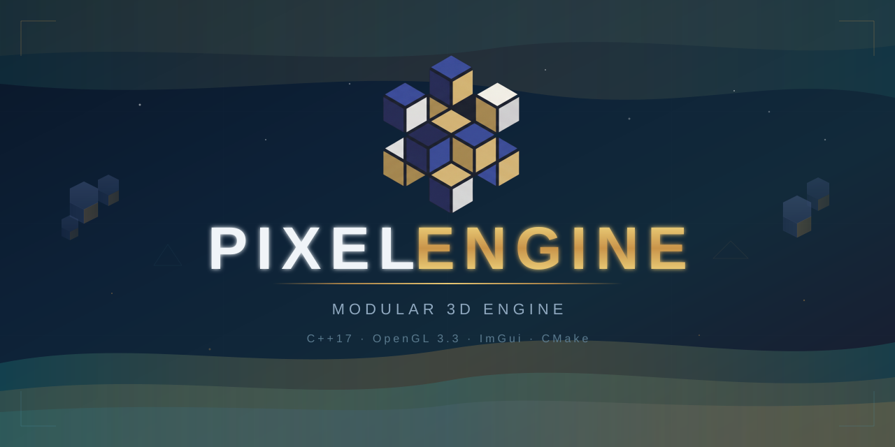
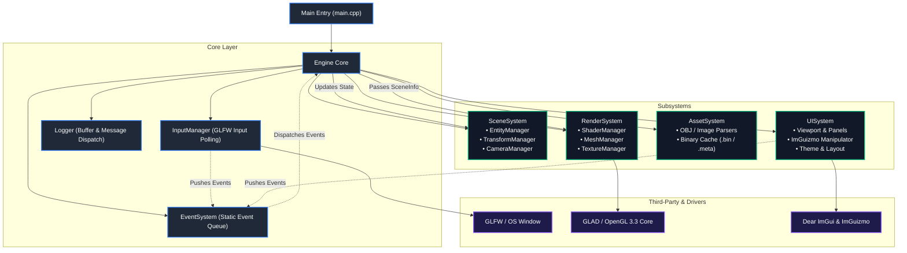
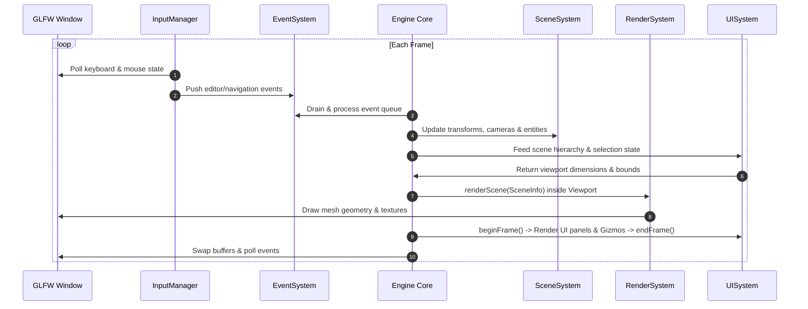

<p align="center">
  
</p>

<p align="center">
  <strong>A modular, lightweight 3D engine and interactive editor built in C++17 and OpenGL 3.3 Core.</strong>
</p>

<p align="center">
  <a href="#about-the-project">About</a> •
  <a href="#key-features">Key Features</a> •
  <a href="#architecture">Architecture</a> •
  <a href="#project-structure">Project Structure</a> •
  <a href="#controls--keybindings">Controls</a> •
  <a href="#building-and-running">Building & Running</a> •
  <a href="#contributing">Contributing</a>
</p>

<p align="center">
  
  
  
  
  
</p>

---

## About the Project

**Pixel Engine** is a high-performance, modular 3D engine and interactive scene editor developed in **C++17** and **OpenGL 3.3 Core Profile**. It is designed around decoupled subsystems, a centralized event-driven communication bus, a robust offline-to-runtime asset pipeline with binary caching, and an intuitive Dear ImGui-based editor with interactive 3D transformation gizmos.

Whether managing entity hierarchies, tweaking materials and color tints in real time, or navigating 3D scenes with 6-DOF camera controls, Pixel Engine provides a clean, extensible foundation for 3D graphics applications and   development experiments.

---

## Key Features

- **Decoupled Event-Driven Core**: Subsystems communicate asynchronously through a centralized `EventSystem` message queue, eliminating tight coupling and spaghetti dependencies.
- **Modern OpenGL 3.3 Core Pipeline**:
  - Programmable vertex and fragment shaders with Model-View-Projection (MVP) transformations.
  - Efficient VAO/VBO/EBO mesh rendering.
  - Dynamic material shading with texture mapping and adjustable color tinting.
- **Entity & Scene Management**:
  - Flexible entity creation, duplication, deletion, and hierarchical tracking.
  - Transform hierarchy supporting position, rotation (Euler angles), and non-uniform scaling with continuous world matrix recalculation.
  - 6-DOF editor camera system with smooth translation and mouse look (Pitch/Yaw).
- **Fast Binary Asset Pipeline**:
  - Supports 3D Wavefront models (`.obj`) and standard image textures (`.png`, `.jpg`, `.jpeg`).
  - Automatically parses original assets and serializes them into optimized `.bin` binary cache formats paired with `.meta` identifier files for near-instant loading.
- **Integrated ImGui Editor Suite**:
  - **3D Viewport**: Embedded OpenGL rendering region dynamically fitted into the UI docking layout.
  - **Scene Hierarchy**: Interactive tree view displaying all active entities with quick selection, renaming, and duplication.
  - **Inspector Panel**: Detailed inspection and editing of transform coordinates, mesh assignment, texture binding, and tint color.
  - **Interactive 3D Gizmos**: Full `ImGuizmo` integration for intuitive Translation, Rotation, and Scaling directly inside the 3D viewport.
  - **Content Browser**: Asset catalog exploring meshes, shaders, and textures.
  - **Console & Diagnostics**: Live system logging (`Logger`) with info, warning, and error filtering.
  - **Custom Dark Theme**: Clean, distraction-free visual design.

---

## Architecture

Pixel Engine adheres to a **modular, layered architecture** where subsystems have single responsibilities and communicate through the `EventSystem` rather than maintaining direct circular references.

### High-Level Subsystem Diagram



### Main Loop & Frame Execution Flow

During each frame tick in `Engine::run()`:



### Subsystems Breakdown

| Subsystem | Responsibility | Key Components |
| :--- | :--- | :--- |
| **`Core`** | Foundation services, input polling, event bus, and diagnostic logging. | `EventSystem`, `InputManager`, `Logger`, `CommonDefinitions` |
| **`SceneSystem`** | Maintains world state, entity lifecycles, transform computations, and active cameras. | `EntityManager`, `TransformManager`, `CameraManager`, `SceneInfo` |
| **`RenderSystem`** | Low-level graphics pipeline, OpenGL state management, shader compilation, and buffer binding. | `ShaderManager`, `MeshManager`, `TextureManager` |
| **`AssetSystem`** | Scans raw asset directories (`.obj`, `.png`, `.jpg`), builds metadata, and exports fast `.bin` caches. | `AssetSystemMesh`, `AssetSystemTexture`, `AssetInfo` |
| **`UISystem`** | Editor layout, panels, docking, gizmo transformations, and menu operations. | `ViewportPanel`, `SceneHierarchyPanel`, `InspectorPanel`, `ContentBrowserPanel`, `ConsolePanel`, `Gizmo`, `MenuBar` |

---

## Project Structure

```
PIXEL_ENGINE/
├── assets/
│   ├── Objects/              # Raw 3D model files (.obj)
│   ├── Shaders/              # GLSL vertex & fragment shaders
│   ├── Textures/             # Texture image files (.png, .jpg)
│   └── bins/                 # Compiled binary assets (.bin) & metadata (.meta)
├── docs/
│   └── images/               # Repository branding and screenshots
├── src/
│   ├── Core/
│   │   ├── Definitions/      # Engine-wide types, structs, and math aliases
│   │   ├── EventSystem/      # Event dispatch bus and event definitions
│   │   ├── InputSystem/      # GLFW keyboard and mouse event handlers
│   │   └── Logger/           # Diagnostics logger
│   ├── Systems/
│   │   ├── Asset/            # Model & texture loaders and binary serializer
│   │   ├── Render/           # Shader, mesh, and texture managers (OpenGL 3.3)
│   │   ├── Scene/            # Entities, transformations, and cameras
│   │   └── UI/               # ImGui editor layout, panels, theme, and ImGuizmo
│   ├── Engine.h / .cpp       # Central engine coordinator and main loop
│   └── main.cpp              # Application entry point
├── third_party/
│   ├── glad/                 # OpenGL extension loader
│   ├── glfw/                 # Windowing and input library
│   ├── glm-1.0.3/            # OpenGL Mathematics library
│   ├── ImGuizmo.h / .cpp     # 3D manipulation gizmos
│   └── stb_image.h           # Header-only image loader
├── CMakeLists.txt            # CMake build configuration
├── CONTRIBUTING.md           # Code style guidelines and conventions
└── README.md                 # Project documentation
```

---

## Controls & Keybindings

### 3D Viewport Navigation
Navigate the scene camera freely in the 3D viewport:

| Key / Input | Action |
| :--- | :--- |
| **`W` / `S`** | Move Camera Forward / Backward |
| **`A` / `D`** | Move Camera Left / Right |
| **`Space`** | Move Camera Up |
| **`Left Shift`** | Move Camera Down |
| **`Right Mouse Button (Hold)` + Mouse Move** | Rotate Camera (Pitch & Yaw) |

### Transform Gizmos
When an entity is selected in the **Scene Hierarchy** or **Viewport**:

| Shortcut | Gizmo Mode | Description |
| :--- | :--- | :--- |
| **`G` + `1`** | **Translate** | Manipulate entity world position $(X, Y, Z)$ |
| **`G` + `2`** | **Rotate** | Rotate entity along coordinate axes |
| **`G` + `3`** | **Scale** | Resize entity scale uniformly or per-axis |

### General Shortcuts
| Shortcut | Action |
| :--- | :--- |
| **`Escape`** | Close window and exit application |

---

## Building and Running

### Prerequisites

Ensure you have the following installed on your system:
- **C++17 Compiler** (MSVC 2019+, GCC 9+, or Clang 10+)
- **CMake** (version 3.20 or newer)
- **OpenGL 3.3+** compatible graphics hardware and drivers

### Building with CMake (Command Line)

1. **Clone the repository:**
   ```bash
   git clone https://github.com/your-username/PIXEL_ENGINE.git
   cd PIXEL_ENGINE
   ```

2. **Configure the project:**
   ```bash
   cmake -B build -DCMAKE_BUILD_TYPE=Release
   ```

3. **Build the target:**
   ```bash
   cmake --build build --config Release
   ```

4. **Launch the engine:**
   ```bash
   # On Windows:
   ./build/Release/PIXEL_ENGINE.exe
   ```
   *(Assets and default configs are automatically copied to the executable directory during post-build).*

### Building with Visual Studio or CLion
- **Visual Studio**: Open the root folder (`File -> Open -> Folder...`), let CMake configure, select `PIXEL_ENGINE.exe` as the startup item, and press **F5**.
- **CLion**: Open the project directory, select the `PIXEL_ENGINE` run configuration, and press **Run** or **Debug**.

---

## Contributing

Contributions, issues, and feature requests are welcome!

Before submitting pull requests, please review [CONTRIBUTING.md](CONTRIBUTING.md) to ensure adherence to project conventions:
- **Classes / Structs**: `PascalCase` (e.g. `CameraManager`, `SceneSystem`)
- **Class Member Variables**: `m_` prefix (`m_cameraID`), with `m_p` for raw pointers (`m_pRenderSystem`)
- **Functions & Methods**: `camelCase` (e.g. `initialize()`, `processEditorEvents()`)
- **Local Variables**: `snake_case` (e.g. `viewport_width`)

---

## Acknowledgments & Libraries

Pixel Engine is powered by open-source libraries:
- [GLFW](https://www.glfw.org/) – Window management and input handling
- [GLAD](https://glad.dav1d.de/) – Multi-Language GL/GLES/EGL/GLX/WGL loader
- [GLM](https://github.com/g-truc/glm) – Mathematics library for graphics software
- [Dear ImGui](https://github.com/ocornut/imgui) – Immediate Mode Graphical User Interface
- [ImGuizmo](https://github.com/CedricGuillemet/ImGuizmo) – Immediate mode 3D gizmo manipulator
- [stb_image](https://github.com/nothings/stb) – Image loading library
