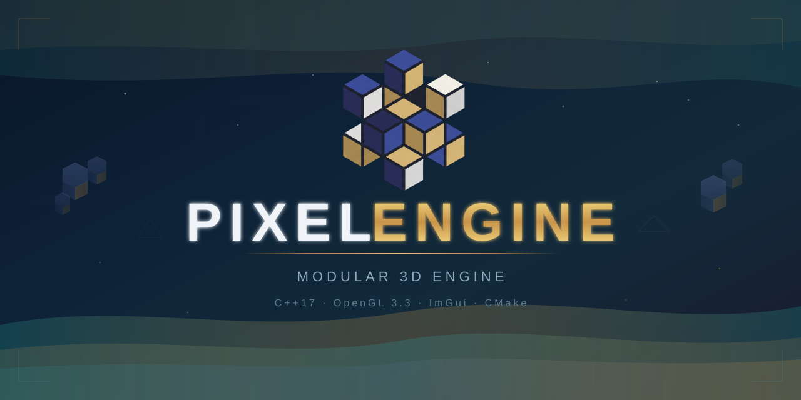

<p align="center">
  
</p>

<h1 align="center">PIXEL ENGINE</h1>

<p align="center">
  <strong>A modular, lightweight 3D engine and interactive editor built in modern C++17 and OpenGL 3.3 Core.</strong>
</p>

<p align="center">
  <a href="#-overview">Overview</a> •
  <a href="#-features">Features</a> •
  <a href="#-architecture">Architecture</a> •
  <a href="#-controls">Controls</a> •
  <a href="#-building--running">Building & Running</a> •
  <a href="#-project-structure">Structure</a> •
  <a href="#-acknowledgments">Credits</a> •
  <a href="#-license">License</a>
</p>

<p align="center">
  
  
  
  
  
  <a href="LICENSE.md"></a>
</p>

---

## 🌟 Overview

**Pixel Engine** is a cross-platform, modular 3D engine and real-time scene editor. It provides a clean, extensible codebase for experimentation with 3D graphics, scene graphs, and interactive tooling.

The architecture emphasizes **loose coupling**: modules communicate asynchronously via a centralized event bus, keeping the rendering pipeline, scene tree, asset compiler, and UI completely independent.

---

## ✨ Features

* **⚡ Event-Driven Decoupled Core**: Zero circular dependencies between subsystems — communication runs through an asynchronous `EventSystem` message bus.
* **🎨 Modern OpenGL 3.3 Core Pipeline**:
  * Programmable GLSL shaders with Model-View-Projection (MVP) transformation stack.
  * Fast VAO/VBO/EBO mesh rendering with index buffering.
  * Dynamic material shading with diffuse texturing and real-time color tinting.
* **🌐 Entity & Scene Graph**:
  * Entity lifecycle: instant creation, duplication, activation toggles, and deletion.
  * Hierarchical transform system supporting world/local space matrix recalculation (Translation, Euler Rotation, Scale).
  * 6-DOF flycam camera controller with smooth keyboard navigation and mouse look.
* **📦 Smart Binary Asset Pipeline**:
  * Parses Wavefront models (`.obj`) and standard images (`.png`, `.jpg`, `.jpeg`).
  * Compiles assets into optimized `.bin` binary caches paired with `.meta` identifiers for instant subsequent startups.
* **🖥️ Integrated Dear ImGui Editor Suite**:
  * **3D Viewport**: Dedicated render window fitted dynamically into the editor layout.
  * **Scene Hierarchy**: Interactive entity tree with selection, renaming, and duplication.
  * **Inspector**: Live tweaking of transforms, materials, textures, and tint colors.
  * **Interactive 3D Gizmos**: Full `ImGuizmo` integration for intuitive Translate / Rotate / Scale in the viewport.
  * **Content Browser**: Asset explorer with native cross-platform file dialogs.
  * **Console**: Filtered runtime diagnostic logging (`Info`, `Warning`, `Error`).

---

## 🏛️ Architecture

Pixel Engine is organized into distinct, single-responsibility modules:

| Subsystem | Key Components | Responsibility |
| :--- | :--- | :--- |
| **`Core`** | `EventSystem`, `InputManager`, `Logger` | Central event queue, GLFW input polling, diagnostics buffer. |
| **`SceneSystem`** | `EntityManager`, `TransformManager`, `CameraManager` | World state, entity lifecycles, hierarchical matrix math, cameras. |
| **`RenderSystem`** | `ShaderManager`, `MeshManager`, `TextureManager` | Low-level OpenGL bindings, GLSL compilation, VAO/VBO/EBO buffers. |
| **`AssetSystem`** | `AssetSystemMesh`, `AssetSystemTexture` | Asset scanning, metadata generation, offline-to-cache `.bin` compiler. |
| **`UISystem`** | Panels, `ImGuizmo`, `EditorTheme`, `EditorLayout` | ImGui docking layout, gizmo manipulators, theme styling. |

---

## 🎮 Controls

### 3D Viewport Camera
Hold the **Right Mouse Button** in the viewport to activate flycam mode:

| Input | Action |
| :---: | :--- |
| <kbd>W</kbd> / <kbd>S</kbd> | Move Forward / Backward |
| <kbd>A</kbd> / <kbd>D</kbd> | Move Left / Right |
| <kbd>Space</kbd> | Move Up |
| <kbd>Left Shift</kbd> | Move Down |
| <kbd>RMB</kbd> + **Mouse Move** | Look Around (Pitch & Yaw) |

### 3D Transform Gizmos
Select any entity in the **Scene Hierarchy** or **Viewport** to manipulate it:

| Shortcut | Mode | Description |
| :---: | :---: | :--- |
| <kbd>G</kbd> + <kbd>1</kbd> | **Translate** | Move entity along $(X, Y, Z)$ axes |
| <kbd>G</kbd> + <kbd>2</kbd> | **Rotate** | Rotate entity along Euler axes |
| <kbd>G</kbd> + <kbd>3</kbd> | **Scale** | Scale entity uniformly or per-axis |
| <kbd>Escape</kbd> | — | Close window and exit application |

---

## 🚀 Building & Running

### Prerequisites

* **C++17 Compiler** (GCC 9+, or Clang 10+)
* **CMake** 3.20 or newer
* **OpenGL 3.3+** compatible graphics hardware

<details>
<summary><b>🐧 Linux Dependencies (Click to expand)</b></summary>

Install the required development packages before configuring:

```bash
# Ubuntu / Debian / Linux Mint:
sudo apt update && sudo apt install -y build-essential cmake libx11-dev libxrandr-dev libxinerama-dev libxcursor-dev libxi-dev libgl1-mesa-dev zenity

# Arch Linux:
sudo pacman -S --needed base-devel cmake libx11 libxrandr libxinerama libxcursor libxi mesa zenity

# Fedora:
sudo dnf install -y gcc-c++ cmake libX11-devel libXrandr-devel libXinerama-devel libXcursor-devel libXi-devel mesa-libGL-devel zenity
```
</details>

---

### Command Line (Debug Build)

#### 🪟 Windows (PowerShell / Command Prompt)
```powershell
# 1. Clone with submodules
git clone https://github.com/your-username/PIXEL_ENGINE.git
cd PIXEL_ENGINE
git submodule update --init --recursive

# 2. Configure & Build Debug
cmake -B build -DCMAKE_BUILD_TYPE=Debug
cmake --build build --config Debug

# 3. Launch
.\build\Debug\PIXEL_ENGINE.exe       # For Visual Studio generator
# .\build\PIXEL_ENGINE.exe           # For MinGW / Ninja generator
```

#### 🐧 Linux
```bash
# 1. Clone with submodules
git clone https://github.com/your-username/PIXEL_ENGINE.git
cd PIXEL_ENGINE
git submodule update --init --recursive

# 2. Configure & Build Debug
cmake -B build -DCMAKE_BUILD_TYPE=Debug
cmake --build build

# 3. Launch
./build/PIXEL_ENGINE
```

#### 🍏 macOS
```bash
# 1. Clone with submodules
git clone https://github.com/your-username/PIXEL_ENGINE.git
cd PIXEL_ENGINE
git submodule update --init --recursive

# 2. Configure & Build Debug
cmake -B build -DCMAKE_BUILD_TYPE=Debug
cmake --build build

# 3. Launch
./build/PIXEL_ENGINE
```

> [!TIP]
> Assets (`assets/`) and configuration files (`imgui.ini`) are automatically copied next to the executable post-build.

---

### Building in IDEs

* **CLion**: Open the project folder, set the active CMake profile to **Debug**, and press **Run** (<kbd>Shift</kbd> + <kbd>F10</kbd>).
* **Visual Studio**: Open folder (`File -> Open -> Folder...`), choose `x64-Debug`, set `PIXEL_ENGINE.exe` as the startup target, and press <kbd>F5</kbd>.
* **VS Code**: Open folder with the **CMake Tools** extension, select **[Debug]** build variant, and press <kbd>F5</kbd>.

---

## 📁 Project Structure

```text
PIXEL_ENGINE/
├── assets/
│   ├── Objects/              # Raw Wavefront 3D models (.obj)
│   ├── Shaders/              # Vertex (.vert) & Fragment (.frag) GLSL shaders
│   ├── Textures/             # Texture images (.png, .jpg)
│   └── bins/                 # Auto-compiled binary cache (.bin) & metadata (.meta)
├── docs/                     # Branding, banners, and documentation assets
├── src/
│   ├── Core/                 # EventSystem, InputManager, Logger, Shared Definitions
│   ├── Systems/
│   │   ├── Asset/            # Model & texture parsers and binary serializer
│   │   ├── Render/           # Shader, mesh, and texture managers (OpenGL 3.3)
│   │   ├── Scene/            # Entity manager, transform hierarchy, cameras
│   │   └── UI/               # ImGui editor suite, layout docking, theme, gizmos
│   ├── Engine.h / .cpp       # Central coordinator and game loop
│   └── main.cpp              # Application entry point
├── third_party/              # GLAD, GLFW, GLM, ImGui, ImGuizmo, stb_image, tinyfiledialogs
├── CMakeLists.txt            # Unified CMake configuration
└── README.md
```

---

## 🤝 Contributing

Contributions, feedback, and suggestions are welcome! Please check [CONTRIBUTING.md](CONTRIBUTING.md) for code style guidelines and naming conventions.

---

## 💖 Acknowledgments

Pixel Engine is built with the help of these great open-source libraries:
* [GLFW](https://www.glfw.org/) – Window context and input management
* [GLAD](https://glad.dav1d.de/) – OpenGL 3.3 Core extension loader
* [GLM](https://github.com/g-truc/glm) – Mathematics library for graphics
* [Dear ImGui](https://github.com/ocornut/imgui) – Immediate Mode GUI framework
* [ImGuizmo](https://github.com/CedricGuillemet/ImGuizmo) – Immediate mode 3D gizmos
* [stb_image](https://github.com/nothings/stb) – Image loading library
* [tinyfiledialogs](https://sourceforge.net/projects/tinyfd/) – Native cross-platform file dialogs


---

## 📄 License

Pixel Engine is free software: you can redistribute it and/or modify it under the terms of the **GNU General Public License v3.0** as published by the Free Software Foundation. See the [LICENSE.md](LICENSE.md) file for full details.